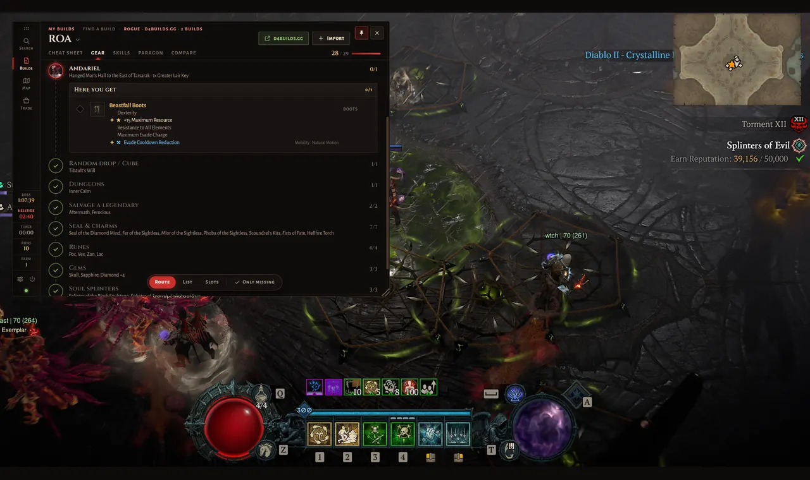
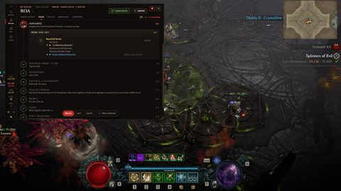
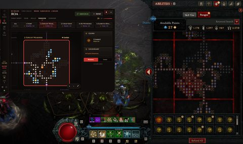
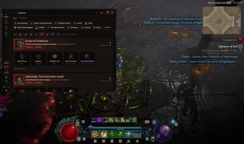
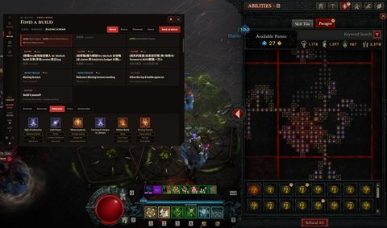
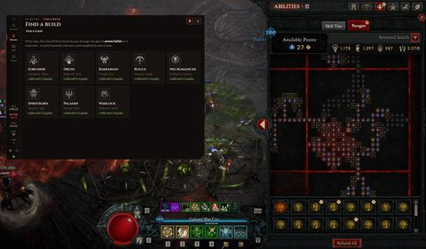
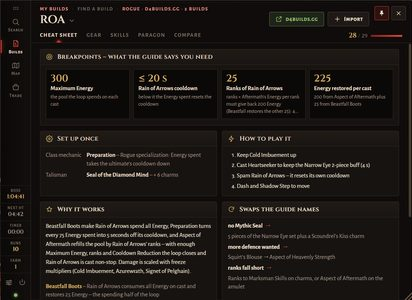
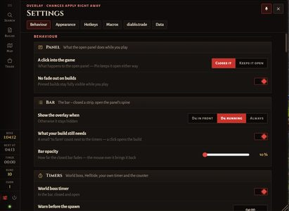
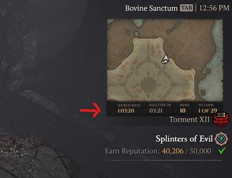

# D4 Overlay

[](https://github.com/editwcrld/d4ovi/releases/latest)
[](https://ko-fi.com/itsun)

A small always-on-top companion for Diablo IV (windowed mode, Windows): item search, boss loot,
crafting, your builds and what is still to farm, a build finder, the map tool, diablo.trade and
the world boss, Helltide and your own timers — next to the game, without alt-tabbing.

It does not read or change the game's memory or files — it reads public web pages and shows
them next to the game. Download the portable `.exe` above and start it; nothing to install.

**A hobby project**, made with [Claude](https://claude.ai). It is free and only meant to help
people play — everything it shows comes from the sites listed under *Credits* below, and
without them and the work they put in it would not be possible. All credit goes to them.
If it helps you, a [coffee](https://ko-fi.com/itsun) is welcome — it stays free either way.

<p align="center"></p>

<table>
<tr>
<td align="center" width="25%"><a href="docs/screenshots/gear-route.jpg"></a><br><sub>Your build's route: where to go, what drops there</sub></td>
<td align="center" width="25%"><a href="docs/screenshots/paragon.jpg"></a><br><sub>Paragon boards next to the game's</sub></td>
<td align="center" width="25%"><a href="docs/screenshots/boss-loot.jpg"></a><br><sub>Boss loot, by your class</sub></td>
<td align="center" width="25%"><a href="docs/screenshots/find-a-build.jpg"></a><br><sub>Find a build: proven builds explained</sub></td>
</tr>
<tr>
<td align="center" width="25%"><a href="docs/screenshots/classes.jpg"></a><br><sub>Pick a class, then a skill</sub></td>
<td align="center" width="25%"><a href="docs/screenshots/cheat-sheet.jpg"></a><br><sub>The cheat sheet of a build</sub></td>
<td align="center" width="25%"><a href="docs/screenshots/settings.jpg"></a><br><sub>Settings on one page</sub></td>
<td align="center" width="25%"><a href="docs/screenshots/closed-bar.jpg"></a><br><sub>Closed: timers and what is left to farm</sub></td>
</tr>
</table>

## Credits

Without these cool websites this overlay would not be possible <3:

- [maxroll.gg](https://maxroll.gg) – game data, boss loot, crafting, activities, the iconic mythics, build guides and the tier list
- [d4guides.gg](https://d4guides.gg) – item database, icons, in-game tooltips, the farm list's items and aspects
- [d4builds.gg](https://d4builds.gg) – build guides
- [d2core.com](https://www.d2core.com) – skill trees, paragon boards, stat texts, build planner and proven builds
- [infinitybuilds.gg](https://infinitybuilds.gg) – builds and their guides
- [diablo.trade](https://diablo.trade) – trading, chat and the world boss timer
- [sunderarmor.com](https://sunderarmor.com) – pictures of the uniques, bosses and classes

## The look

The overlay reads like a page of the game's own journal ("Codex"): ash black, parchment text,
blood red for what you act on, gold for numbers, Cinzel for titles. Every page is built from the
same few parts (renderer/ui.js, and the stylesheet – written in `styles/`, built into renderer/style.css):

- **the bar** – closed a slim strip (timers, lock, the sections); open the **spine** on the left of
  the panel: the sections with their names, the timers, settings and quit
- **the page** – its head (what you look at, or the search field; pin and close on the right),
  its tabs in small caps with a red diamond under the one shown, its body
- **the plate** – every part of a page sits on one: a head (icon, title, a line on it, a badge)
  and its body
- **the line** – every thing on a plate: its picture, its name in its rarity's colour, what it is,
  and on the right a count, a tick or buttons
- **the tick** – the game's diamond, wherever something is ticked off
- **one hover card** for everything: the in-game tooltip, a slot's rolls, a charm, a guide line

**Pictures for everything.** Every unique, mythic, aspect, charm, seal, set, gem, rune, soul
splinter and runeword has its picture – lib/icons.js builds one map by name from the farm catalog
(d4guides.gg), maxroll's game data (every item's picture id) and d2core's gems, runes, splinters,
charms and seals (the same game ids, served by maxroll). An aspect shows its category's picture,
as the codex does; a set the picture of its first piece; a boss trophy ("Duriel: Shard of Agony")
its item's.

**Every size.** The open panel is made for the room left of the game's inventory, skill tree and
paragon: **820 × 600** at 1080p (the zoom grows it with the screen, up to twice on 4K). *Settings →
Appearance → Size → Panel size*: Small (700 × 510), Medium, Large (985 × 720) or **Mobile** (393 ×
850, tall and narrow like a phone). The corner bottom right drags any size from 360 × 400 up; the
text grows a little with the width (13 px at 560, 15 at 820). Below 900 wide the search results
become chips over the picked one; below 760 two columns become one; below 600 the spine turns into
a tab bar at the bottom with the timers above it. Nothing overlaps or runs out of its box at any
of these sizes (checked page by page). The panel and the strip are dragged by the bar or the
page's head.

## The bar

Closed, the bar is a strip with the timers and lock only: drag handle · world boss · Helltide ·
your own timer · (to farm) · (lock). The mouse over it slides the section icons, settings and quit
out to the right (those switched on for it) – at the right edge of the screen to the left, its
right end staying put; leaving, they slide back in. Opening a section – by a click, a timer or a
hotkey – the panel grows out of it; closing, it folds back into that corner and the strip fades in
at its place. Open, the bar is the panel's spine. The strip and the panel each keep their place
(dragged by hand); being kept on the screen for a moment never moves it.

**Lock** (only in a build with the macros, see the end) shows its keys while it runs, as they are pressed ("1234"), in red and still – hover
for which are held and which are timed. While it waits (map, chat, town portal, a left click) they
turn gold, and the label says why. Each icon opens one
section:

| Icon | Section | What it does |
|---|---|---|
| 🔍 | **Search** | One box for everything: items, boss loot, crafting recipes, activities (six maxroll guides: Secret Cow Level, Dark Citadel, Artificer's Tower, Echoing Hatred, Gathering Legions, World Events) |
| 📋 | **Builds** | *My builds*: your farm list – cheat sheet, gear, where each piece drops, skills, paragon. *Find a build*: pick a class and a skill, every site's guides for it explained, or build it yourself — see below |
| 🗺 | **Map tool** | The maxroll map tool, embedded — see below |
| 🛍 | **diablo.trade** | Your listings with your own login — the chat is one click away there; unread messages show a red badge |
| ⚙ | **Settings** | One page: Behaviour · Appearance · Hotkeys · Macros (in a build with them) · diablo.trade · Data – the chips on top jump to a group |

**Closing and pinning.** A click into the game closes the open panel and the bar goes back to the
strip — no Esc needed. **Pin** (top right of every panel, next to ✕) keeps it open: pinned,
it fades back while you play and the mouse over it brings it forward. Nothing pins itself; pinned builds do
not fade (*Settings → Behaviour*). The first time it opens, a short hint explains this.
**The game keeps the focus:** clicking around in the overlay leaves Diablo IV in front (lock keeps
running). The overlay takes the keyboard only while you type — the search, a text field, a key to
record, an embedded page you clicked into — and gives it back right after. The open
panel can be dragged by its spine and its head as well as by the ⠿ handle.

`Ctrl+Shift+F` opens the search from inside the game, `Esc` closes everything and clears the field.
Three more hotkeys can be assigned (show/hide, open map tool, open builds — `Ctrl+Shift+B` by default).

Boss loot and crafting have no icon of their own — typing `boss loot` or `crafting` brings up the
same thing, so the bar stays short. `boss loot` (or `boss drops`) shows every boss at once, the
loot pools below them: portrait, where it is (lair name below), torment tier and key, then its
uniques as tiles — picture, name in its rarity colour, slot. Hovering a tile shows the in-game
tooltip, a click looks the item up. The class bar on top (all eight classes with their icons, and
**All**) starts on your active build's class and shows its drops plus the ones for every class
("5 for Rogue · 25 in all"). An item a boss drops carries that on its own card (*Drops from*:
the boss with its portrait, where it is, what you need, and *Everything … drops →*), so it gets
no separate boss card. A new search always starts on *All*, whatever chip was picked before. The
lair screenshot from the guide opens on request (*Show lair & map*). The portraits, item and class
pictures come from d4builds.gg (sunderarmor.com); one that is missing falls back to ours.

## When nothing is open

Closed — by a click into the game, ✕ or Esc — the bar is the strip right away and fades to the
opacity you set:

```
⠿ │ WORLD BOSS 2:15:40 │ HELLTIDE 13:47 │ TIMER 05:00 │ RUNS 9      (mouse over: … │ 🔍 📋 🗺 🛍 │ ⚙ ⏻)
```

The timers keep their full strength; in the warning time (*Warn before the spawn*, 5:00 by default — typed
like every time here: `10` is 10 seconds, `15:15` 15 min 15 s, `30m`, `1h`) the world boss timer turns red, grows
the closer the spawn gets and blinks — a click stops the blinking. Otherwise a click on the timer
opens again whatever was open last (builds, diablo.trade, a guide …), the search if nothing was.
Moving the mouse over the strip only takes the fade off — it keeps its shape and its place, so you
can drag it there.

Next to the world boss sits the **Helltide** timer: orange while a Helltide runs (how long it
still has) and red for its last 3 minutes, grey while there is none (when the next one starts).
It needs no data source — a Helltide starts on every full hour and runs 55 minutes, then 5
minutes pass. It never blinks.

Then **your own timer**. Set its name (*Timer* by default) and its time (5:00 by
default, up to 99:59:59 — `90` (seconds), `1:12` (m:ss), `1:30:00`, `15m10s` or `1h`; lock's timed keys take
the same, with tenths: `5.2`, `5,2`) in the settings, and
whether it counts **down** from that time, **up** from 0:00 to it, or is a **stopwatch**. Counting down or up, a click
starts it, another click starts it over, a right click clears it; for its last 30 seconds it turns red and blinks, at 0 it turns green and says
**ready**. As a stopwatch it just counts the time: a click starts it, the next stops it, the next puts
it back to 0:00 (a right click too). Clicking it never opens the panel. Handy for a boss without a schedule — the Fields
of Hatred boss is back about five minutes after it died.

Then a **counter** (*Runs* by default, the name is yours): a click adds one, a right click starts it
at 0 again; it keeps its count over a restart. *Settings → Hotkeys → Counter: +1* adds one without
taking the focus from the game. Like the timers it can be left out of the closed bar.

*Settings → Hotkeys → Build: skills* / *Build: paragon* open the active build straight on that
page (pressed again, it closes).

*Settings → Hotkeys → Start the own timer* gives it a hotkey (a single F-key works) — it works like
a click on it, without taking the focus from the game.

*Settings → Behaviour → Bar → What your build still needs* adds a **To farm** count next to the
timers: how many items, aspects, charms and gems of the active build are not ticked off yet
(green **done** once everything is). A click opens the build. Off by default.

Everything about the timers is in *Settings → Behaviour → Timers*: each one can be switched off
on its own (*World boss timer*, *Helltide timer*, *Own timer*). *Settings → Appearance → Closed bar →
What it shows while closed* (the very first row there) switches each thing in the strip on or off:
search, builds, map tool, diablo.trade, the world boss, Helltide and own timer, to farm, settings
and quit. The handle (and the Lock tag while it runs) always stays; the spine keeps everything.
By default all but the map tool show.

Alerts punch through the fade and blink **on their own element only**: the timer when the world
boss is closer than your warning threshold, the diablo.trade icon when a message arrives.

Each of the two states keeps its own place on the screen: drag the strip where you want it while
it is closed, the panel while it is open (by default top left – the room left of the inventory). Both are saved as `posIdle` and `posOpen`, and
*Settings → Appearance → Places* resets them.

## Backup

*Settings → Data → Backup*: choose a folder (one that OneDrive or Dropbox syncs keeps a copy off
the PC), then *Back up now* — or switch on *Every day* for one backup a day when the overlay
starts. Each backup is a folder of its own (`D4-Overlay-Backup-<date>_<time>`) with your settings,
builds and map progress; the newest 10 are kept. The login is never part of
it. To restore, copy the files back into the data folder while the overlay is closed.

## Tray and updates

The icon in the Windows tray (its menu starts with *D4ovi*) shows or hides the overlay (a click,
or the menu), starts Diablo IV (the path from *Settings → Data → Advanced*), opens Search,
Builds or Settings and quits. Hidden from the tray, the overlay stays hidden until it is
shown there again.

When switched on (*Settings → Data → Updates*, off by default), the overlay asks GitHub once a day for the latest release of this repository. A newer version
puts a green dot on Settings; *Settings → Data → Updates* links to it. Nothing is downloaded or
installed by itself, and the check can be switched off there. (It needs published releases in a
public repository — otherwise it says "no release published yet".)

## Search

Type a name and you get the item with its icon, rarity, type, required level and power, plus
which boss drops it and which recipes use it. The card shows what the item does as the game's
tooltip does (power and effects); three small icons favourite it, copy its name or search it
on **diablo.trade** (the search field is filled in for you).
The results sit above it as chips in two rows – what does not fit is counted on a last chip
("+5 more"), which opens them all ("less" folds them again), so no result hides behind a scrollbar.
The results are a list on the left — tile, name in its rarity colour, what it is and where it
comes from (the boss, the loot pool) — and the picked one in full on the right, the first one
until you pick another; ↑ ↓ walk the list. A narrow panel shows the list, then the picked one
with *← Results*. The tabs above (All · Items · Bosses · Crafting · Activities) filter, a new
search always starts on All. The list is grouped (Items, Bosses, Runewords …), each group with a
small head — icon, name, how many; on a card *How to get it*, *Drops from* and a boss's drops sit
under small heads of their own. A guide or page opened from a result loads behind a spinner, has
*← Back*, and typing in the search field goes back to the results.
Favourites (★) and recent searches are kept — a search counts as recent once you stop typing for a moment, and *Clear* next to the heading empties the list.

Add a keyword to narrow it down — in English:

| Input | Result |
|---|---|
| `ber` | everything matching, with the rune **Ber** first |
| `ber rune` | only the rune and what you can craft with it |
| `insight runeword` | only the runeword and its recipe |
| `annihilus seal` | only the seal |
| `duriel boss` | only the boss loot table |
| `crafting` | every recipe group and all runewords |
| `boss loot` | every boss and loot pool |
| `activities` | all six guides |
| `iconic` | all 13 iconic mythic uniques, with how to get them |

Recognised: rune, runeword, gem, aspect, skill, charm, seal, talisman, key, sigil, material,
set, unique, mythic, iconic, legendary, item, glyph, affix, paragon, boss, recipe, activity.

Mythic uniques carry a **How to get it** line taken from maxroll's equipment page — the iconic
ones say that they drop in the wild or cost 3x Resplendent Sparks at the Blacksmith, the normal
ones list the Horadric Cube recipe and the gambling options.

## Builds / farm list

Builds is one place with two halves, switched in its head: **My builds** (the farm list, below) and
**Find a build** (class → skill → every guide for it, see *Builder*).

`Ctrl+Shift+B` (changeable under *Settings → Hotkeys*) opens it. Like every panel it does not pin
itself — **Pin** is always your own click; pinned builds stay fully visible while you play
(*Settings → Behaviour → No fade out on builds*).

On top: the build (a click opens the build menu in three parts — *Builds* with how many there are,
*This build* to name it and pick the class, *More* for *+ New farm list*, *Copy build code*,
*Export all to file …*, duplicate, delete); on the right its source as a green button (opens the
original guide in your browser – the cheat sheet's foot has the same) and *Import*. Below: **Cheat sheet · Gear ·
Skills · Paragon · Compare**, and at the end of that row how much of it is farmed.

**Cheat sheet** — the build on one page, before the gear: the **breakpoints** the guide's author
names as big numbers (300 Maximum Energy, ≤ 20 s cooldown, 23 ranks …), **Set up once** (the class
mechanic — Specialization, Soul Shard and Fragment, Enchantments, Oath, Weapon Technique, Spirit
Boons — the mercenary, the reinforcement with its skill and what sets it off, the talisman), **How to
play it** (the author's rotation), **Why it works** and the swaps the guide names. Hover a line for
the author's own words. Breakpoints, rotation and why come from the recipes d4builder reads out of
the authors' notes (Chinese notes too — the recipes are English), bundled as
`lib/data/recipes.json` (`node tools/sync-recipes.js` takes over new ones from `../d4builder`); the
mechanic and the mercenaries from the build's own data when it is imported. A build of your own
shows what the guides for its main skill say.

**Crafting marks** — one symbol per step, the same on every card, explained under it:
✦ greater affix · ★ masterwork (reroll the capstone until it lands here) · ⚒ temper (Blacksmith,
**one per item** — a second one a site saved, or a skill augment's "+100 All Stats" placeholder, is
left out; augments go by their name: "Flurry hits twice – skill augment") · ↻ enchant · ◈ transfigure.

**Gear** has three views; the one you used last stays.

- **Route** (the default) — where to go, in order, as a path with a waypoint per stop: each boss
  ("The Butcher", "Andariel" … with its portrait), *Runewords*, *Dungeons* for aspects, *Salvage a
  legendary*, then *Seal & charms*, *Runes*, *Gems* and *Soul splinters*, each with how much of it
  you have; a finished stop gets a green tick. The stop you are at (the first one not finished, or
  the one clicked) opens right there on the path: what you get there – the item with its picture
  in its rarity colour, its slot, the rolls of the build (greater affixes ✦, tempered lines ⚒),
  its sockets, and the diamond tick. Things from the same boss sit together.
- **List** — everything at once, one calm column, grouped the same way: one plate per place with
  its icon and how much is left there ("3 to farm"); in it picture, name and slot, the rolls right
  under it. What you have sinks to a dimmed *Farmed* plate at the end.
- **Slots** — the build as the game shows it: armour on the left, jewellery and weapons on the
  right, each with its picture and what it is ("Mythic Unique Helm", "Unique Bow"). In the
  middle what is socketed where (the slot under each group of gems and runes) and the skill bar —
  a click on a skill opens the skills, zoomed to it. Beside it the seal and the charms. Hovering an
  item shows a card with this build's rolls, where it drops and its sockets.

Seal, charms, gems, runes and soul splinters count as things to farm like the items: each has a
tick and goes into the progress on top. A gem needed twice shows "×2" and what it is for
("for Bow, Off-Hand"); hovering a charm shows its card with the set bonuses (lit when enough
pieces are worn; the seal can lower that). Where gems, runes and splinters come from is a general
hint, not taken from a data source.

Route, List, Slots and *Only missing* sit in the toolbar under the list. *Only missing* hides what you have. A click on a name opens the search dropdown for that slot —
type to filter, *Unique / Mythic / Aspect* switch what it lists, `Enter` takes the first hit,
`Esc` closes it; a legendary slot takes an aspect (two on the amulet). Ticking, folding and
redrawing keep the place in the list. Weapons are named by their kind: a rogue has a bow and two
blades (*Weapon*, *Off-Hand*, *Weapon 2*), a barbarian up to four (*Weapon 3*). An item that exists
for several weapon kinds — a runeword like Infinity, a unique like Spirit — shows the picture and
tooltip of the kind the build uses (Infinity on a bow, not the scythe).

**Import.** One field: paste a link from maxroll, d4builds, infinitybuilds or d2core (Chinese, translated) or a
build code — the site is recognised, the variants load by themselves and are ticked, *Import*
adds them. A builds file can be dropped on the dialog or picked with *Import file …*.

**Skills.** The skill bar as cards – picture, name, rank as the game's pips, its upgrades
numbered in the order they are taken – then the passives as medallions (when the tree data has
them), then the whole skill tree in d2core's layout on its own plate, with every node the build
took lit — hover a node for its text at that rank. The cards are in the tree's order, top to bottom. A click on a skill — in the bar, in the tree (a modifier counts for
its skill) or in the slots view — zooms the tree in on it and lights it and its modifiers up
(again: back out). maxroll saves the tree by the game's node ids and d2core by skill ids, so both
land on the same drawing — infinitybuilds.gg too, it keeps the game's node ids as well. d4builds.gg serves its skill tree data encrypted; for its builds the bar
is shown and a button opens d4builds' own tree inside the overlay.

**Paragon.** The boards as a film strip on top (name, the glyph's round picture and its rank), the first one shown
big to start with, *All* for the whole chain. Beside it the board's glyph as the game draws it (green while rare, orange from rank 46) and its
legendary node (showing all: every glyph). The boards sit on their grid, turned as in the build,
the nodes taken lit up by rarity, the glyph's picture in its socket — as plain squares (*Minimal*) or with the
game's node icons (*Icons*); switching keeps where you zoomed to. The names sit in the gap above
each board, gates that touch are joined by a line. A click on a board — in the strip or in the
drawing — lights it up and moves the view to it (again: all back). All sites land on
d2core's board drawings: d2core, maxroll and infinitybuilds by board key, d4builds by board name. Both views zoom
with the wheel and move by dragging; ⤢ fits everything again.

- The class (build menu) filters what each slot offers; every option already says where it drops.
- Hovering an item or aspect in the dropdown shows its **in-game tooltip** (frame, rolls, flavour
  text), taken from d4guides.gg.
- **From a build site** — *Import* takes a link from one of four sites and lists the build's
  variants (Starter, Midgame, Endgame …) with the one the link points at marked; the ticked ones
  become builds:

  | Site | Link |
  |---|---|
  | maxroll.gg | build guide (`maxroll.gg/d4/build-guides/…`) or planner (`maxroll.gg/d4/planner/…#4`) |
  | d4builds.gg | `d4builds.gg/builds/<id>/?var=1` — `var` picks the variant |
  | infinitybuilds.gg | `infinitybuilds.gg/en/builds/<name>-<id>?variant=v-…` — any language; `variant` picks the variant |
  | d2core.com | `d2core.com/d4/planner?bd=23TM` (Chinese site) |

  Uniques and runewords come in by name (season-tagged game ids like `S05_BSK_Helm_…` included),
  legendaries by their aspects (two on the amulet — the sanctified / transfigured one is the
  second), with their rolls and sockets, the seal and charms, skills and paragon; the class is
  taken over, and an item the overlay does not recognise is reported instead of guessed. Every
  weapon keeps its kind (maxroll, d2core and infinitybuilds name it exactly, d4builds only "Ranged Weapon" /
  "Dual-Wield Weapon").

  d2core is in Chinese, but its gear uses the game's own ids, so every item and aspect comes in
  with its exact English name. Only what players wrote — build title and variant names — is
  translated: game names (skills, items, aspects, sets, glyphs) from maxroll's game data in both
  languages, build jargon (天塔 = Pit, 速刷 = speed farm …) from a short glossary. Unknown words
  stay as they are; the original title is shown on hover.

  infinitybuilds names gear in its author's language too, but by the game's ids — the English
  names, the roll ranges and the skills d2core lacks (the Warlock's commands) come from the data
  the site draws its own tooltips from. Seal and charm stats are saved without their rolls; like
  the site, they show the best roll (a quarter more when greater). Glyph levels are not saved.
- **Compare** — a move *from* the open build *to* another one — by default another variant of
  the same guide (Starter → Endgame), otherwise one of the same class. Three numbers on top: how
  many pieces change, how many of them you have, how much is left to farm (a click lists it by
  where it drops). Then one line per slot that changes: old → new in its rarity colour and where
  the new piece drops, or "you have it". Skills, paragon, glyphs and talisman are one chip each
  ("Dash → Shadow Step", "same"); the slots that stay and the same items with other rolls fold out
  from a chip. *Switch to it* opens the other build.
- **Several builds** — new, duplicate, rename, delete (build menu). They are saved in
  **`builds.json`** in the data folder, so they travel with it like the map progress. *Copy build
  code* gives one build as a short code (`D4B1:…`) for a chat or the other PC, *Export all to
  file …* writes all of them; *Import* takes both. Imports never overwrite: a name that exists
  gets " (2)".

Where things come from: boss drops, the General Unique Pool, the mythics and the season capstone
items from maxroll's boss loot sheet; everything without a dedicated source is "random drop /
Horadric Cube". Aspects are unlocked by salvaging a legendary that carries them — or, for 84 of
them, by completing a named dungeon. Which slots an aspect fits and which dungeon unlocks it is
only in its tooltip; the overlay reads those once in the background (d4guides allows about 120
requests a minute, so it takes ~5 minutes on the very first start) and keeps them.

### The codex: aspects count in every build

An aspect you tick goes into your **codex** — once you have it, it is done in every build that
uses it (as in the game, where an aspect in the codex is there for every gear piece). Untick it
in any build and it is gone from the codex again. Uniques, charms, gems and runes stay ticks of
their own build. A `builds.json` from before takes every aspect ticked anywhere into the codex.

## Builder

*Builds → Find a build.* Drawn like the rest of the overlay: where you are, its views and *Save* in the page's tab row, the page scrolls as one (only the skill tree and the boards move inside). For players who follow guides and want to make a build of their own. Pick a **class**, then the
**skill** that should do the damage: the skills with guides come first — S-Tier, A-Tier … by
maxroll's tier list, then the ones with guides only on the other sites — each with how many guides
there are, the rest after them by kind. The build opens on one sheet: skill bar on top, the gear as the game shows
it, what the picked piece does on the right.

**Where the build comes from** — a row of cards above the sheet:

- **Proven builds** first: maxroll's tier list, d2core's most liked builds of the season,
  infinitybuilds' most liked (Mekuna, Rob …) and the d4builds guides d4builder has read, one site
  after the other — each card with the author's breakpoints at a glance. Each opens with **What the
  author says** (breakpoints, set up once, how to play it, why it works — as on the cheat sheet), then
  explained by the damage model — *What the damage model sees*: where the damage comes from, crits (or why a damage-over-time skill
  ignores them), where Vulnerable comes from, what keeps it alive, speed (Enigma's Teleport),
  Leoric's Crown and the soul splinters it boosts, what the build relies on, and what the model
  cannot count. Every piece shows its share (what the build loses without it), its stats and
  sockets in that build, and *6/8* — in how many of the top builds it appears.
- **What the top builds agree on** — the most used piece per slot, the skills, sockets and
  charm sets they share.
- **Build it yourself** — starts from what the top builds use per slot; the model fills only the
  slots they leave open (one mythic at most, an aspect once). The model reads item texts and cannot
  see everything a build relies on (procs, set and runeword interplay), so its own pick for every
  slot is there too, marked *experimental* — and is what a skill without proven builds starts
  with. A unique's fixed stats replace the rolls of its slot, they never count on top; and every
  piece is measured at the level the proven builds of the skill reach (crit, attack speed, ranks,
  damage reduction …) – 25% attack speed is a lot at none and little near the cap. *Make it my
  own* on a proven build starts from that one. Click a slot (*Change*) or
  search: every option says what it adds on top of everything else you wear (+% damage, toughness,
  speed). *Build for* Pit push / Speed farm / Bosses weighs damage, toughness and speed.
  *Conditional boosts* are bonuses that only work while something is true (Berserking, an Elite,
  "to isolated enemies" …): the ones the build provides are on, each other one says what it would
  add — switch it on and the gear is picked again. Each skill on the bar shows its modifiers; a
  click lists the three variants and both upgrade pairs with what they add.

*Skills* and *Paragon* show the build's skill tree and boards (see **Paragon** below). *Goals* is
about this build, not builds in general: **How this build works**
– the skill's loop piece by piece and its breakpoints, what the build has against what it needs
(see *Mechanics* below); **What this build wants most now** – one more of every stat it can roll,
valued on the build as it stands; then the build next to the top builds, stat by stat (crit
chance, attack speed, cooldown reduction, skill ranks, damage reduction, movement speed – both
from the gear), with the slots a stat that falls short rolls on. **Save as build** puts it
into the farm list — the gear with the rolls to look for (★ masterwork, ⚒ tempers), sockets and
runes, the skill bar and modifiers (lit in the skill tree, the main skill at its last rank, the key
passive), the paragon boards turned and joined at their gates, the talisman — or a proven build
exactly as imported.

**How the numbers are made** (`lib/dmgmodel.js`, `lib/optimizer.js`):

```
damage = weapon × skill % × main stat × (1 + [+] pool) × (1 + damage multipliers) × every [x]
         × crit (on crits) × Vulnerable (on Vulnerable enemies) × damage over time
crit   = (A + crit damage [+]) / A × 1.5 × (1 + crit damage multiplier), A = 1 + [+] pool
lucky hit effect = skill's Lucky Hit Chance × (1 + Lucky Hit Chance from gear) × the effect's chance
speed  = 1 + attack speed (cap 100%) + cast speed (cap 100%)
```

from d4guides' *Damage Calculation* (patch 3.2.2, the model gives its worked example to the
point) and maxroll's *In-Depth Damage Guide*. Toughness as maxroll's defence guide (Season 11+)
works it out: per damage type, life over Armor (against all damage), that type's Resistance and
every other damage reduction, multiplied, averaged over the six types – Armor and Resistance are
ratings, `R / (R × 10/9 + C)` with C = 5678 / 1136 at level 70, no caps any more; Strength adds 2
Armor a point, Intelligence 0.4 Resistance; dodge (`1 − Π(1 − dodge)` + 0.6% per 100 Dexterity)
comes on top. Item, aspect, splinter and gem texts are read into effects
— value, [x] or [+], who the sentence is about (your skill, a group it is in, or a side effect
like Arrow Storms), the condition it needs, drawbacks. Procs ("unleash a Rank 20 Chain
Lightning", Crushing Blow) are shown, not guessed as a number. The souls a Splinter of the Black
Soulstone counts are a slider.

**Mechanics** – what makes a strong build more than its numbers. Top builds hang on a few
patterns (read out of maxroll's guides and the notes of d2core's most liked Season 15 builds),
and the model reads them out of every text, for every class:

| pattern | read from | example |
|---|---|---|
| a cast spends the whole pool for x%[x] per point | "Consumes all of your Energy … per Energy Consumed" | Beastfall Boots |
| spending takes seconds off a cooldown | "Spend 75 Energy to reduce your Ultimate Skill's Cooldown by 5 seconds" | Preparation (Rogue specialization) |
| a cast gives the pool back, per rank | "generates 11 Energy per Skill Rank" | Aspect of Aftermath |
| damage per point of the pool held | "0.50%[x] … per point of Fury you have" | Ramaladni's Magnum Opus, Seed of Horazon |
| a bigger pool | "+20 Maximum Resource", "Primary Resource is increased by 100%" | Melted Heart of Selig |
| a buff after each cast, counted by its uptime | "Casting an Ultimate Skill increases your damage by 55%[x] for 8 seconds" | Vehement Brawler's Aspect |
| a skill that lasts – up while its cooldown is not longer | game data: "follows you for 8 seconds" | Cataclysm |
| the skill becomes one of another group | "Blazing Scream is now an Archfiend Skill" | Elegy, Indira's Memory, The Third Blade |
| no Cooldown Reduction | "This ritual does not benefit from Cooldown Reduction" | Apocalypse |
| casting one skill takes seconds off others | "Casting an Ultimate Skill reduces the Cooldowns of your other Skills by 10 seconds", "… and vice versa", Lucky Hit "Reduce the active Cooldowns of your Trap Skills by 30%" | Aspect of Apogeic Furor, Synergy, the Orange Herald, Misericorde |
| the resource budget | "+4 Fury Regeneration", "15% Resource Generation", "7% Cost Reduction", Lucky Hit restores, "7% Fury Drains per second", "free to cast" | Ramaladni's drain, Rod of Kepeleke |
| more hits a cast | "the Lesser Demon skulls deal the same damage as the main skull" – counted as at least one more full hit | Elegy |

`cycle()` plays the main skill through a dozen casts – what each spends, what that takes off the
cooldown, what comes back – and gives the **breakpoints**: Rain of Arrows with those three needs
300 Energy and ~60% Cooldown Reduction to clear its 50 s cooldown and enough ranks for Aftermath to
refill the pool (maxroll's guide: 300 Energy, 61%); below that it is a step, not a slope.

**Cooldown chains** (`chainTimes`): every skill on the bar with a cooldown, cast when it is ready,
with the seconds the other casts take off it – skill *i* comes back every `T_i = base_i / (1 + Σ_j r_ji / T_j)`
(in `T_i` seconds skill *j* is cast `T_i / T_j` times, each taking `r_ji` off), played to a fixed
point; the main skill counts as a source too. The buffs the bar keeps up (Berserking, Unstoppable,
Fortify, Barrier, Vulnerable, crowd control, Frozen – read with their seconds from the skill text)
count **by their uptime**: a bonus "while Fortified" from an aura up half the time counts half, and
Cooldown Reduction or a chain that keeps it up all the time raises it – the goals show each such
skill's breakpoint ("Cooldown Reduction to keep Sigil of Chaos up").

**Resource budget** (`sustain`): a spender cast non-stop costs `cost × casts a second × (1 − Cost
Reduction)` plus drains; in come regeneration (gear, buffs, and the base value the player reads off
the character sheet – the game data has none, it is a field in the goals) and Lucky Hit restores,
raised by Resource Generation. Short of it, the generator on the bar fills the gap and the spender
is cast `m = (generator + income) / (spend + generator)` of the time. Its breakpoint: income ≥ spend.

The builder works with all of it: a loop only pays off whole, so its pieces are also tried as a
package, every specialization or key passive a loop hangs on is tried, a piece that gives the
skill a tag has the whole build read again with that tag. The **breakpoint chase** puts the stat
that closes an open breakpoint (Maximum Resource, Cooldown Reduction, ranks, regeneration, Resource
Generation, Cost Reduction, restores) on slot after slot in place of the roll that costs least, and
tries the pieces that move it (a Lucky Hit restore aspect, a cooldown chain) – the whole build
decides whether that beats what it had. A cast takes one second at no speed – assumed, the game
data has no animation lengths.

**Stats and tempers** are picked by the model for the build as it stands, not from a list: three
affixes per legendary, one temper (shown with its category – Offensive,
Defensive, Utility, Mobility, Resource, Weapons – and manual) on any piece, uniques keep their own
stats. With every other piece in place, a slot gets what this build lacks – Maximum Resource where
a loop spends the pool, the skill's own cooldown temper, crit damage where it crits; a temper for
another skill group ("Frost Critical Strike Chance") is nothing to a skill outside it. ★ marks the
affix the masterwork capstone (+50% to one affix) is worth most on – reroll until it lands there;
⚒ marks a temper. "+100 All Stats" in the data is no temper: d2core and maxroll both carry it as
the text of the skill augments ("Flurry hits twice") whose real text neither has – left out.
Swapping a piece picks them again. Every tile shows its card on hover (as in the farm list).

**Sockets** – per slot what adds the most: gems by their weapon, armour or jewellery power, soul
splinters in jewellery only (or a helm that counts as jewellery, Leoric's Crown, at 1.5×), a
runeword's own runes, and **rune pairs** in two-socket armour: a condition rune gains Offering when
the build does its thing (Tam: a non-channeled Core cast, Yul: a skill with a cooldown, Zan: an
Ultimate, Poc: 5% of the pool spent, Cir, Igni, Ort, Tal – how often comes from the model's casts,
chains and budget), an effect rune spends it (Ohm, Vex, Gar, Sol, Qua – effect × how often it can
fire, by its cooldown). Conditions that hang on how you play (Evade, potions, taking no damage) and
effects the model cannot count (procs, Gold Find) are left out.

**Class choices** – the player's own picks besides skills and gear, from the game data, each the
one that adds most on the build: Sorcerer enchantments (two – the slots "Legacy of the Magi" opens;
"Chain Lightning forms automatically after spending 100 Mana" is a free cast per 100 spent),
Druid spirit boons (one per spirit and one more), Paladin oath, Barbarian weapon expertise (the
technique slot, rank 10), Warlock shard, Rogue specialization. They count in every number.

**Paragon** – worked out on the build, board by board: every gate tried as the way in (that is the
board's rotation) and every other as the way out to the next board, which hangs on there (up or to
a side). On each board: the legendary node and the glyph socket first, then the glyph's threshold
("40 Intelligence within range") as one package of the nearest nodes of that attribute inside its
radius (Manhattan distance, as d2core's planner counts it), then whatever adds most per point – a
node's own value plus what its attribute points give the glyph – keeping the way to the gate out
free. A board is taken for its legendary node first; one whose legendary does nothing for the
build only when nothing better is left. 220 points, glyphs at rank 100 (radius 5, legendary bonus).
The Skills and Paragon views are the farm list's own (icons or minimal), drawn on what *Save as
build* would keep – before anything is saved.

**Talisman** – a Mythic seal's 6 charm slots filled by the model: a set by its 2/3/5 bonuses,
Unique Charms (the power of their unique item, 147 in Season 15), a Mythic Charm. Three ways side
by side: a Mythic seal (one Unique Charm, two with the Hellfire Torch), the Seal of the Golden
Epiphany ("Can equip up to 3 Unique Charms"), and the **seal swap** – charms put in under the
Golden Epiphany, then that seal swapped for the Seal of the Diamond Mind ("Reduces the number of
Charms needed for Set bonuses by 1"), the Unique Charms stay. The swap is a Season 15 trick
reported by players and may be fixed any time; the build counts the plain Mythic seal.

Data: maxroll's game data (skills, modifiers, sets, tiers), d2core's item files (uniques with
their fixed stats and runewords, aspects, soul splinters, gems, affixes per slot, tempers,
paragon), maxroll's tier list, d2core's and infinitybuilds' build lists — the proven builds come
in through the overlay's own importers. Kept in `builder-db.json`, fetched weekly (the tier list
daily); proven builds once a day per skill.

## Map tool

The maxroll map tool is **embedded**, not rebuilt — it is a canvas application with no open data
source, so a copy would be worse and would break with every patch. Embedded you get all layers
and filters, without ads.

It tracks what you found by itself (`Altar of Lilith 0/190`, `Side Quest 0/311`, …) and stores
that locally — no account involved. The overlay keeps that storage in its own data folder, so
your marks are there after a restart, and additionally writes them to **`map-progress.json`**.
That file is how progress moves to another PC: copy it (or the whole data folder) and the
overlay plays it back. It never overwrites newer local progress unless you press
*Restore map progress* in the settings.

## Login (once)

⚙ → **diablo.trade** → *Sign in*. The session cookie is made permanent automatically (30 days),
so you stay signed in across restarts. If signing in does not work, paste your cookies instead
(browser → F12 → Application → Cookies → diablo.trade).

## Sizing

Everything scales with the screen: text, icons and spacing grow on a large display and stay at
the base size on 1920×1080. **Text size** can be nudged further in the settings, and the open
panel uses a share of the screen (small / medium / large). Embedded pages — map, chat, database —
get more room than a result list.

The corner at the bottom right of the panel sets your own size (*Settings → Appearance → Your own
size* resets it); the corner stays under the mouse while you drag. Made narrow, everything goes to
one column: the search shows the list, then the picked result with *← Results*; the
route, the slots and the settings rearrange the same way, at the same text size.

| Screen | Search / settings | Map / chat / database |
|---|---|---|
| 1920 × 1080 | 960 × 645 | 1306 × 832 |
| 2560 × 1440 | 1200 × 868 | 1500 × 1120 |
| 3840 × 2160 | 1200 × 1314 | 1500 × 1400 |

## Where the data lives

The portable build keeps **everything next to the .exe**:

```
D4-Overlay-portable.exe
D4-Overlay-Data\            ← created automatically
   settings.json
   items-cache.json  d4guides-cache.json  maxroll-cache.json
   crafting-cache.json  activities-cache.json  mythics-cache.json
   farm-cache.json  farm-tooltips.json  maxroll-names.json  zh-dict.json  d2core-db.json  builder-db.json
   map-progress.json  builds.json
   Partitions\trade\        ← your diablo.trade login
   overlay-log.txt          ← restarts past 1 MB, the one before is overlay-log.old.txt
```

Copy that folder to carry everything to another PC. If the .exe sits somewhere without write
access (e.g. `C:\Program Files`), it falls back to `%APPDATA%\D4 Overlay`.

Note: your diablo.trade login is inside that folder. When you pass the app to a friend, give
them **only the .exe**.

## Data sources

| Source | Used for | Refresh |
|---|---|---|
| Maxroll game data (`data.min.json`) | item database (~8400 entries), local | weekly |
| d4guides.gg (`api/v1/db-search.php`) | icons, rarity, category, detail page | per search |
| d4guides.gg list pages | extra columns (charm slots, effect, origin) | every 3 days |
| maxroll.gg *Boss Loot Table Cheat Sheet* | boss loot | daily |
| maxroll.gg *Crafting Cheat Sheet* | runewords & recipes | daily |
| maxroll.gg guides | activities | every 3 days |
| maxroll.gg *Equipment* page | iconic mythics + how to obtain | every 3 days |
| d4guides.gg item + aspect lists | farm list: slot, class, rarity | every 3 days |
| d4guides.gg `api/v1/tooltip.php` | in-game tooltips, aspect slots + dungeons | once, then cached |
| maxroll.gg build guide + `planners.maxroll.gg/profiles/d4/<id>` | build import | when you import |
| maxroll `data.enus.json` | item + aspect names by game id (for the import) | weekly |
| d4builds.gg (public Firestore document `builds/<id>`) | build import | when you import |
| d2core.com (CloudBase function `function-planner-queryplandetail`, anonymous) | build import | when you import |
| d2core.com database (`cloudstorage.d2core.com/data/d4/<build>/…_enUS.json`) | stat texts, skill tree, paragon boards | weekly, on first use |
| maxroll `data.min.json` + d2core `uniqueItem`, `aspect`, `affix`, `soulSplinter`, `gem` | builder: skills, items, effects, rolls per slot | weekly, on first use |
| maxroll.gg *Endgame Tier List* | builder: S / A marks, proven builds | daily |
| d2core.com `function-planner-queryplanlist` (anonymous), infinitybuilds.gg build list | builder: proven builds per skill | daily, when a skill is opened |
| maxroll `data.enus.json` + `data.zhcn.json` | Chinese → English dictionary for d2core titles | weekly, on the first d2core import |
| diablo.trade (signed out page) | world boss timer | every 15 s |
| diablo.trade `api/chat/conversations` | unread messages | every 15 s |

The timer and the unread count come from two different places on purpose: diablo.trade only
shows the event bar to signed out visitors, so the hidden window that reads the countdown uses
its own session without the login, while the unread count is fetched from the site's own API
with the signed in one.

## Running it

```
npm install
npm start          # run from source
npm run dist       # build dist\D4-Overlay-<version>-portable.exe (without the macros, see Building)
npm test           # all offline tests
npm run css        # build renderer/style.css from styles/ (never edit style.css itself)
npm run ui-check   # every page at every size: screenshots + overlap check (tools/ui-check/out)
npm run web-check  # the same for the website
node test/builder-live.js   # the builder against the real sites (needs the internet)
```

### Building

```
npm run dist       # the .exe without the macros – the one to share (also the download above)
npm run dist --m   # the .exe with the macros (lock, click spam) – build it for yourself
npm start --m      # run from source with the macros
```

`tools/dist.js` bakes the choice into the build; without the macros there is no *Macros* tab and
the helper that sends input is never started (`lib/features.js`).

### How the code is laid out

The overlay's page is split by area – `renderer/app.js` (state, opening and closing, start-up),
`strip.js` (the bar's motions), `timers.js`, `searchview.js`, `settingspage.js` – classic
scripts sharing one scope, loaded before `app.js`, which starts the page. The stylesheet is
written in `styles/` and built into `renderer/style.css` (`npm run css`). The main process keeps
hotkeys and data loading in `main.js`; where the window goes is `lib/windowplace.js`; what the
pages ask for is served by area (`lib/searchipc.js`, `lib/buildsipc.js`, `lib/builderipc.js`).
Every request goes through `lib/netfetch.js`: a site that does not answer within 15 s fails
instead of hanging, and is left alone for a minute.

If something misbehaves at runtime, `overlay-log.txt` in the data folder records cookie changes,
view navigation, zoom and data loading.

## Macros (not in the download)

The optional *Macros* (click spam and lock) are the exception to "it only reads web pages": they
send mouse clicks and key presses to the game window. Blizzard's terms do not allow automating game
input, so using them can put your account at risk. They are all **off** until switched on in
*Settings → Macros*, each one past a "use at your own risk" warning — and a build can leave them
out entirely (`lib/features.js`, see *Building*).

**The committed build and the `.exe` to download come without them.** If you want them anyway,
download the code and build it yourself with `npm run dist --m` — at your own risk.

- **Click spam** – hold Mouse 4 / Mouse 5 (or a key of your choice) and it keeps clicking right /
  left, 1–40 clicks a second.
- **Lock** – a toggle key (F9) holds the keys you list down, or presses each on its own timer; the
  map, the chat, the town portal and your own left click pause it. Key lists per character.

Both only send input while Diablo IV is the window in front, and let go of everything when it is not.
